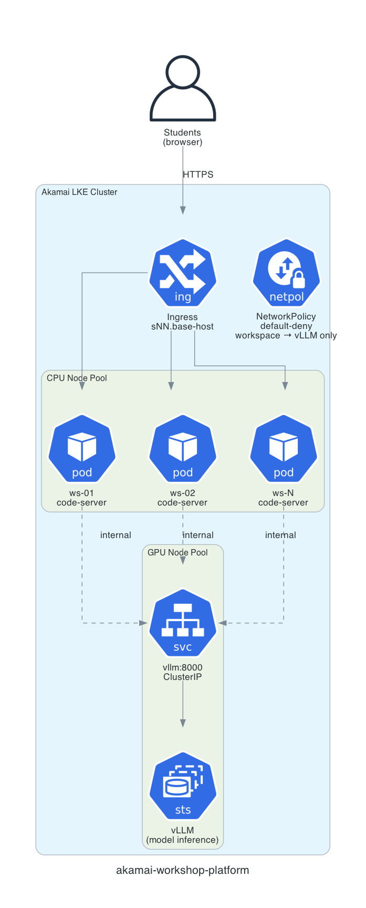

# akamai-workshop-platform

Provision a GPU classroom on [Akamai Cloud](https://www.linode.com/) with one command, hand each student a URL and a password, and tear it all down when class ends.

Every student gets a browser IDE (JupyterLab or [code-server](https://github.com/coder/code-server)), a [vLLM](https://github.com/vllm-project/vllm) model served on GPUs, a copy of the workshop content, and their own HTTPS URL. You pick a workshop, confirm the cost, and get a CSV of student URLs and passwords.

<p align="center">
  
</p>

## Workshops

Three workshops ship as presets. A preset sets the content repo, editor, model, and cluster shape in one pick.

| Preset | Content | Editor | Inference | Model | 20 students, 4 hours |
|---|---|---|---|---|---|
| `solution-architect-agent` | [akamai-workshop-solution-architect-agent](https://github.com/akamai-developers/akamai-workshop-solution-architect-agent) | JupyterLab | One shared vLLM. Each student also gets a namespace, a kubeconfig, and an Object Storage bucket | Qwen/Qwen2.5-7B-Instruct | about $10 |
| `ai-agents` | [ai-agents-workshop](https://github.com/akamai-developers/ai-agents-workshop) | code-server | One shared vLLM | Qwen/Qwen3-8B-FP8 | about $10 |
| `own-inference` | [akamai-workshop-ai-inference](https://github.com/akamai-developers/akamai-workshop-ai-inference) | JupyterLab | One vLLM per student on its own GPU, which the student tunes with kubectl | Qwen/Qwen3-4B | about $43 |

Costs are the node prices from `./deploy.sh --dry-run` and cover nodes only. The NodeBalancer and student volumes add a few dollars a day. The platform clones any git repo into the workspaces, so your own content works too. See [`examples/README.md`](examples/README.md).

## Prerequisites

- An [Akamai Cloud account](http://login.linode.com/signup?promo=akm-dev-git-300-31126-M055) and an API token. The token needs Read/Write on Kubernetes, Linodes, Firewalls, NodeBalancers, Volumes, and Object Storage, plus Domains if you bring a domain.
- [Terraform](https://terraform.io) 1.5 or later, [kubectl](https://kubernetes.io/docs/tasks/tools/), and [Helm](https://helm.sh/) 3.
- `bash`, `python3`, and `openssl`. All three come with macOS and Linux.

You do not need a Hugging Face token. Every model in the catalog is ungated. You do not need Docker.

Export the token as `LINODE_TOKEN` or `TF_VAR_token`. Either name works. If both are set, the deploy tests each against the API and uses the first one that works. The token is never written to a file.

## Quick start

```bash
export LINODE_TOKEN="your-linode-api-token"

# 1. Preview the plan and the cost. This creates nothing.
./deploy.sh --dry-run --preset own-inference --students 20

# 2. Deploy. The wizard asks for a name, class size, workshop, model, domain,
#    and region, then shows the cost and waits for a yes before it creates anything.
./deploy.sh

# 3. Hand out access.
cat infra/manifests/generated/access-cards.csv        # student_number, url, password
./infra/scripts/print-access-cards.sh                 # printable HTML, one card per student

# 4. Tear down when class ends. This stops billing.
./deploy.sh teardown
```

> [!WARNING]
> GPU nodes bill by the hour. Run `./deploy.sh teardown` as soon as class ends, then check that the cluster is gone in Cloud Manager.

A deploy takes 20 to 30 minutes. The `own-inference` shape takes longer because every student's vLLM downloads its models.

For scripted runs, copy `config.example.yaml` to `config.yaml`, edit it, and run:

```bash
./deploy.sh --yes --config config.yaml
```

`make help` lists the Makefile wrappers for the same commands.

## Domains and TLS

Bring a domain that Linode DNS hosts and the platform creates the records and a free Let's Encrypt wildcard certificate. Students get trusted HTTPS with no browser warning:

```bash
./deploy.sh --domain example.com
# Students get: https://s01.workshop.example.com/
```

Without a domain, the platform uses [sslip.io](https://sslip.io) hostnames and a self-signed certificate. The connection is encrypted, but browsers show a warning that students accept once. Use this for internal tests. Use a real domain for anything customer facing.

## Inputs

| Input | Default | Meaning |
|---|---|---|
| `label` | `ai-agents-workshop` | Deployment name. Becomes the LKE cluster label. CLI: `--name` or `--label` |
| `students` | `80` | Number of student workspaces |
| `preset` | none with `--yes`; `solution-architect-agent` in the wizard | One of the three workshops above, or `custom`. A preset only fills values you left unset |
| `model` | `Qwen/Qwen3-8B-FP8` | Any ungated Hugging Face model id. `make models` lists the catalog. Comma-separated ids deploy several models behind one gateway |
| `content_repo` | `""` | Git repo cloned into each workspace at startup. Blank uses `ai-agents-workshop`. Accepts a URL, `owner/repo`, or a bare name |
| `domain` | `""` | Blank uses sslip.io and a self-signed certificate. A domain uses Linode DNS and Let's Encrypt |
| `region` | nearest GPU region | Picked from the live list of GPU regions. GPU stock varies by region and by day |
| `k8s_version` | auto | 1.37 when LKE offers it, otherwise the newest LKE offers |

Anything you leave out, the wizard fills in: GPU plan, tensor parallel size, replica and node counts. The per-student components behind the presets (editor, inference, cluster access, Object Storage, GPU sharing, agent deploy) are documented in [`infra/docs/components.md`](infra/docs/components.md) and listed in `config.example.yaml`.

## Good to know

- **Capacity.** The wizard checks the public GPU stock feed before it provisions, but that feed is advisory. The provision itself is the real test. If a region is out of stock, pick another one.
- **Inference is private.** vLLM and the multi-model gateway sit behind ClusterIP services and a default-deny NetworkPolicy. From outside the cluster, the only way in is `kubectl port-forward`.
- **Object Storage policy.** Every bucket the platform creates uses an E3 endpoint, and buckets never go to `us-sea`. A `us-sea` cluster keeps its buckets in `us-ord`.
- **Large classes.** LKE caps a node pool at 100 nodes, so the GPU pool splits into pools of 100 when needed. Above a few dozen students, seed a model mirror in Object Storage so Hugging Face does not throttle the downloads. See [`infra/docs/components.md`](infra/docs/components.md).
- **Content updates.** After you push to the content repo, `make refresh-content` pulls it into every running workspace. No redeploy.

## Documentation

- [`infra/docs/quickstart.md`](infra/docs/quickstart.md): deploy, port-forward, and teardown step by step
- [`infra/docs/runbook.md`](infra/docs/runbook.md): the classroom-day checklist
- [`infra/docs/components.md`](infra/docs/components.md): the per-student components, the model mirror, and classes over 100
- [`infra/docs/architecture.md`](infra/docs/architecture.md): the layers, the Helm chart, multi-model routing, and workspace environment variables
- [`infra/docs/sizing.md`](infra/docs/sizing.md) and [`infra/docs/cost.md`](infra/docs/cost.md): GPU plans, the sizing formula, and the hourly bill
- [`infra/docs/gpu-sharing.md`](infra/docs/gpu-sharing.md): two models on one GPU with time-slicing
- [`infra/docs/security.md`](infra/docs/security.md) and [`infra/docs/troubleshooting.md`](infra/docs/troubleshooting.md): the security model and what to do when something breaks
- [`examples/README.md`](examples/README.md): bringing your own content
- [`PLAN.md`](PLAN.md) and [`infra/docs/dev.md`](infra/docs/dev.md): design notes and verification steps for contributors

## About the author

This project was created by Du'An Lightfoot, a developer who works on AI agents and cloud infrastructure and teaches in public.

- Website: [duanlightfoot.com](https://duanlightfoot.com)
- YouTube: [@LabEveryday](https://www.youtube.com/@LabEveryday)
- GitHub: [@labeveryday](https://github.com/labeveryday)
